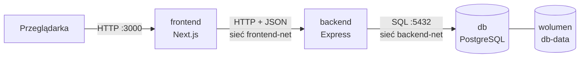

# Wypożyczalnia rowerów i samochodów

Projekt z przedmiotu **Metody wirtualizacji** (Cyberbezpieczeństwo, sem. 3, Politechnika Poznańska, 2026/2027).

Aplikacja webowa do wypożyczania rowerów i samochodów, zbudowana jako trzy osobne kontenery
(frontend, backend, baza danych) uruchamiane przez Docker Compose.

**Zespół:** Filip Piątek, Jakub Bilski, Mikołaj Kortus

## Architektura



- **Frontend łączy się wyłącznie z backendem.** Przeglądarka wysyła zapytania na `/api/...` do frontendu,
  a serwer Next.js przekazuje je do backendu w sieci Dockera.
- **Baza jest w osobnej sieci** (`backend-net`, `internal: true`): dostęp do niej ma tylko backend,
  frontend nie widzi jej nawet po nazwie. Port bazy nie jest wystawiony na zewnątrz.
- **Dane przetrwają restart kontenerów** - baza zapisuje je w nazwanym wolumenie `db-data`.
- Hasła i adresy są w zmiennych środowiskowych (plik `.env`, którego nie ma w repozytorium).

| Usługa | Technologia | Obraz | Port na hoście |
|---|---|---|---|
| `frontend` | Next.js 16, TypeScript, Tailwind CSS, shadcn/ui | własny (`frontend/Dockerfile`) | `3000` |
| `backend` | Node.js 24, Express 5, TypeScript, `pg` | własny (`backend/Dockerfile`) | `127.0.0.1:4000` (do testów API) |
| `db` | PostgreSQL 18 | oficjalny `postgres:18-alpine` | brak |

## Uruchomienie

Wymagany Docker z Docker Compose.

```bash
git clone git@github.com:mikipiki082/Metody_wirtualizacji_projekt.git
cd Metody_wirtualizacji_projekt

cp .env.example .env
# w pliku .env ustaw POSTGRES_PASSWORD, np. wynik: openssl rand -hex 16

docker compose up --build
```

Po starcie:

- aplikacja: <http://localhost:3000>
- API backendu: <http://localhost:4000/health>, <http://localhost:4000/vehicles>

Kontenery startują w kolejności: `db` → `backend` → `frontend`. Każdy kolejny czeka,
aż poprzedni przejdzie healthcheck (`depends_on: condition: service_healthy`).

### Przydatne polecenia

```bash
docker compose ps                 # stan kontenerów i healthchecków
docker compose logs -f backend    # logi backendu na żywo
docker compose down               # zatrzymanie (dane w bazie zostają)
docker compose down -v            # zatrzymanie i usunięcie wolumenu z danymi
```

Skrypty z `db/init/` (schemat i przykładowe dane) wykonują się **tylko przy pierwszym starcie**,
gdy wolumen jest pusty. Po zmianie tych plików trzeba zresetować bazę: `docker compose down -v`.

## API

| Metoda | Ścieżka | Opis |
|---|---|---|
| `GET` | `/health` | Stan backendu i połączenia z bazą (wersja PostgreSQL). `503`, gdy baza nie odpowiada. |
| `GET` | `/vehicles` | Lista pojazdów z bazy. |

```bash
curl http://localhost:4000/vehicles
```

```json
[
  { "id": 1, "type": "bike", "name": "Kross Hexagon 5.0 (górski)", "pricePerDay": 45, "available": true }
]
```

## Struktura repozytorium

```text
.
├── docker-compose.yml     # trzy usługi, sieci, wolumen, healthchecki
├── .env.example           # wzór zmiennych środowiskowych
├── backend/               # API w Express (TypeScript)
│   ├── Dockerfile
│   └── src/
│       ├── index.ts       # start serwera, zamykanie na SIGTERM
│       ├── app.ts         # konfiguracja Express, trasy, obsługa błędów
│       ├── config.ts      # odczyt zmiennych środowiskowych
│       ├── db.ts          # pula połączeń z PostgreSQL
│       └── routes/        # endpointy
├── db/
│   └── init/              # schemat i dane startowe bazy
└── frontend/              # aplikacja Next.js
    ├── Dockerfile
    ├── next.config.ts     # przekierowanie /api/* do backendu
    └── src/
        ├── app/           # strony
        ├── components/    # komponenty (w tym ui/ z shadcn)
        └── lib/api.ts     # komunikacja z backendem
```

## Praca lokalna bez budowania obrazów

Frontend z hot reloadem przy działającym w Dockerze backendzie:

```bash
docker compose up -d db backend
cd frontend && npm install && npm run dev   # http://localhost:3000, /api/* idzie na localhost:4000
```

## Kamienie milowe

- [x] **KM1** - działający szkielet: trzy kontenery, frontend pobiera JSON z backendu, backend łączy się z bazą
- [ ] **KM2** - endpointy backendu
- [ ] **KM3** - baza danych (relacje) i frontend
- [ ] Stan końcowy - zmiany od klienta, testy, dokumentacja

## Wykorzystanie AI

Zgodnie z zasadami przedmiotu informujemy, że przy projekcie korzystaliśmy z narzędzi AI jako pomocy
przy konfiguracji Dockera i pisaniu kodu. Cały kod rozumiemy i potrafimy go wyjaśnić oraz zmodyfikować.
