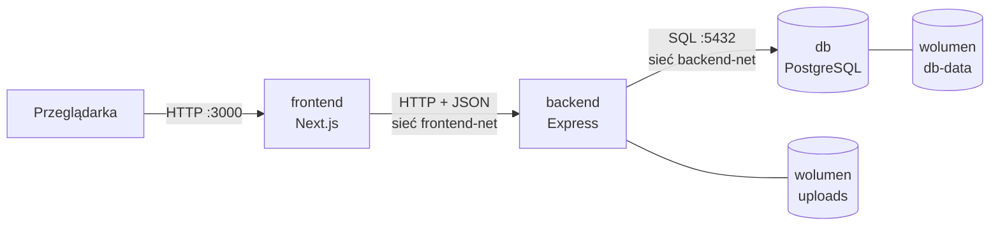

# Redline Rent

Projekt z przedmiotu **Metody wirtualizacji** (Cyberbezpieczeństwo, sem. 3, Politechnika Poznańska, 2026/2027).

Redline Rent to wypożyczalnia sportowych i tuningowanych samochodów oraz rowerów premium. Aplikacja składa się
z trzech osobnych kontenerów (frontend, backend, baza danych) uruchamianych przez Docker Compose.

**Zespół:** Filip Piątek, Jakub Bilski, Mikołaj Kortus

## Architektura



- **Frontend łączy się wyłącznie z backendem.** Przeglądarka wysyła zapytania na `/api/...` do frontendu,
  a serwer Next.js przekazuje je do backendu w sieci Dockera.
- **Baza jest w osobnej sieci** (`backend-net`, `internal: true`): dostęp do niej ma tylko backend,
  frontend nie widzi jej nawet po nazwie. Port bazy nie jest wystawiony na zewnątrz.
- **Dane przetrwają restart kontenerów** - baza zapisuje je w wolumenie `db-data`, a zdjęcia pojazdów
  w wolumenie `uploads`.
- Hasła i adresy są w zmiennych środowiskowych (plik `.env`, którego nie ma w repozytorium).

| Usługa | Technologia | Obraz | Port na hoście |
|---|---|---|---|
| `frontend` | Next.js 16, TypeScript, Tailwind CSS, shadcn/ui | własny (`frontend/Dockerfile`) | `3000` |
| `backend` | Node.js 24, Express 5, TypeScript, `pg`, `multer` | własny (`backend/Dockerfile`) | `127.0.0.1:4000` (do testów API) |
| `db` | PostgreSQL 18 | oficjalny `postgres:18-alpine` | brak |
| `pgadmin` (opcjonalnie) | pgAdmin 4 | oficjalny `dpage/pgadmin4:9` | `127.0.0.1:5050` |

## Uruchomienie

Wymagany Docker z Docker Compose.

```bash
git clone git@github.com:mikipiki082/Metody_wirtualizacji_projekt.git
cd Metody_wirtualizacji_projekt

cp .env.example .env
# w pliku .env ustaw POSTGRES_PASSWORD, np. wynik: openssl rand -hex 16

docker compose up --build
```

Po starcie:

- aplikacja: <http://localhost:3000>
- API backendu: <http://localhost:4000/health>, <http://localhost:4000/vehicles>

Kontenery startują w kolejności: `db` → `backend` → `frontend`. Każdy kolejny czeka,
aż poprzedni przejdzie healthcheck (`depends_on: condition: service_healthy`).

### Podgląd bazy w pgAdmin

pgAdmin jest w osobnym profilu i nie startuje domyślnie:

```bash
docker compose --profile tools up -d
```

Panel: <http://localhost:5050>. Serwer „Redline Rent” jest już dodany, a hasło do bazy pgAdmin bierze z `.env`.

### Przydatne polecenia

```bash
docker compose ps                 # stan kontenerów i healthchecków
docker compose logs -f backend    # logi backendu na żywo
docker compose exec db psql -U wypozyczalnia   # konsola bazy danych
docker compose down               # zatrzymanie (dane zostają)
docker compose down -v            # zatrzymanie i usunięcie wolumenów z danymi i zdjęciami
```

Skrypty z `db/init/` (schemat i przykładowe dane) wykonują się **tylko przy pierwszym starcie**,
gdy wolumen jest pusty. Po zmianie tych plików trzeba zresetować bazę: `docker compose down -v`.

Zdjęcia startowe pojazdów (`backend/seed-images/`) są kopiowane do obrazu backendu. Przy pierwszym
uruchomieniu Docker przenosi je do pustego wolumenu `uploads`, a nowe zdjęcia trafiają już tylko do wolumenu.

## API

| Metoda | Ścieżka | Opis |
|---|---|---|
| `GET` | `/health` | Stan backendu i połączenia z bazą. `503`, gdy baza nie odpowiada. |
| `GET` | `/vehicles` | Lista pojazdów. Filtr `?type=car` albo `?type=bike`, inny typ zwraca `400`. |
| `GET` | `/vehicles/:id` | Jeden pojazd. `400` przy złym id, `404` gdy nie istnieje. |
| `POST` | `/vehicles/:id/image` | Wgranie zdjęcia pojazdu (`multipart/form-data`, pole `image`, JPG/PNG/WEBP do 5 MB). |
| `POST` | `/inquiries` | Zapytanie z formularza kontaktowego. `201` z id, `400` z listą błędnych pól. |
| `GET` | `/uploads/:plik` | Pliki zdjęć. |

```bash
curl http://localhost:4000/vehicles?type=bike
curl -F image=@zdjecie.png http://localhost:4000/vehicles/1/image
curl -X POST http://localhost:4000/inquiries -H 'Content-Type: application/json' \
  -d '{"name":"Jan Kowalski","email":"jan@example.com","vehicleId":1,"dateFrom":"2026-12-04","dateTo":"2026-12-06","message":"Czy auto będzie wolne?"}'
```

Przykładowy pojazd (skrócone listy `specs`, `ratings` i `colors`):

```json
{
  "id": 1,
  "type": "car",
  "brand": "Nissan",
  "model": "GT-R R35",
  "category": "Tuning",
  "year": 2022,
  "description": "Legenda JDM po tuningu: obniżone zawieszenie, karbonowy body kit i ponad 700 KM na czterech kołach.",
  "pricePerDay": 1690,
  "available": true,
  "imageUrl": "/uploads/nissan-gt-r--czarny.webp",
  "specs": [{ "label": "Moc", "value": "720 KM" }],
  "ratings": [{ "label": "Osiągi", "value": 9.6 }],
  "colors": [
    {
      "name": "Czarny",
      "hex": "#0b0b0c",
      "imageUrl": "/uploads/nissan-gt-r--czarny.webp",
      "geometry": { "w": 1400, "h": 535, "xl": 821, "yl": 533, "xr": 1268, "yr": 484 }
    }
  ]
}
```

## Baza danych

| Tabela | Zawartość |
|---|---|
| `vehicles` | pojazdy: typ, marka, model, cena za dobę, dostępność, parametry i oceny (`JSONB`) |
| `vehicle_colors` | warianty kolorów pojazdu ze zdjęciem i punktami styku kół (`vehicle_id` → `vehicles`, usuwane razem z pojazdem) |
| `inquiries` | zapytania z formularza (`vehicle_id` → `vehicles`, po usunięciu pojazdu zostaje `NULL`) |

Ograniczenia pilnuje sama baza: typ pojazdu, dodatnia cena, format koloru `#rrggbb` i data zwrotu
nie wcześniejsza niż data odbioru.

## Jak pokazujemy pojazdy

Każde zdjęcie pojazdu to wycięty obraz bez tła. Frontend sam stawia go na scenie: dorysowuje odbicie
w mokrym asfalcie, cienie pod kołami i mgłę. Żeby pojazd stał równo, dla każdego zdjęcia zapisujemy
w bazie punkty styku obu kół z podłożem (`geometry`). Mierzy je skrypt:

```bash
python3 scripts/vehicle_geometry.py backend/seed-images/*.webp
```

Zdjęcie bez `geometry` (np. wgrane przez `POST /vehicles/:id/image`) wyświetla się zwyczajnie, bez sceny.

## Struktura repozytorium

```text
.
├── docker-compose.yml     # usługi, sieci, wolumeny, healthchecki
├── .env.example           # wzór zmiennych środowiskowych
├── backend/               # API w Express (TypeScript)
│   ├── Dockerfile
│   ├── seed-images/       # zdjęcia startowe pojazdów
│   └── src/
│       ├── index.ts       # start serwera, zamykanie na SIGTERM
│       ├── app.ts         # konfiguracja Express, trasy, obsługa błędów
│       ├── config.ts      # odczyt zmiennych środowiskowych
│       ├── db.ts          # pula połączeń z PostgreSQL
│       ├── upload.ts      # przyjmowanie plików (multer)
│       ├── routes/        # endpointy
│       └── types/         # typy danych
├── db/
│   └── init/              # schemat i dane startowe bazy
├── pgadmin/               # konfiguracja serwera dla pgAdmin
├── scripts/               # pomiar punktów styku kół na zdjęciach
└── frontend/              # aplikacja Next.js
    ├── Dockerfile
    ├── next.config.ts     # przekierowanie /api/* do backendu
    ├── public/            # logo, tła strony, scena pojazdów
    └── src/
        ├── app/           # strony: główna, /samochody, /rowery, /jak-wynajac, /kontakt
        ├── components/    # komponenty strony
        ├── fonts/         # font nagłówków Ave Display
        ├── lib/           # API, scena pojazdu, daty i koszt wynajmu
        └── types/         # typy danych
```

## Praca lokalna bez budowania obrazów

Frontend z hot reloadem przy działającym w Dockerze backendzie:

```bash
docker compose up -d db backend
cd frontend && npm install && npm run dev   # http://localhost:3000, /api/* idzie na localhost:4000
```

## Kamienie milowe

- [x] **KM1** - działający szkielet: trzy kontenery, frontend pobiera JSON z backendu, backend łączy się z bazą
- [ ] **KM2** - endpointy backendu
- [ ] **KM3** - baza danych (relacje) i frontend
- [ ] Stan końcowy - zmiany od klienta, testy, dokumentacja

## Wykorzystanie AI

Zgodnie z zasadami przedmiotu informujemy, że przy projekcie korzystaliśmy z narzędzi AI jako pomocy
przy konfiguracji Dockera i pisaniu kodu. Grafiki (zdjęcia pojazdów, tła i logo) oraz font nagłówków
powstały z pomocą AI. Cały kod rozumiemy i potrafimy go wyjaśnić oraz zmodyfikować.
