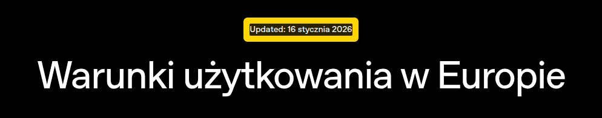
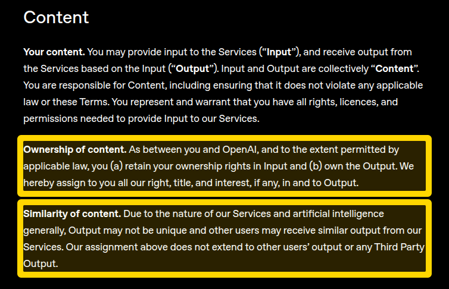
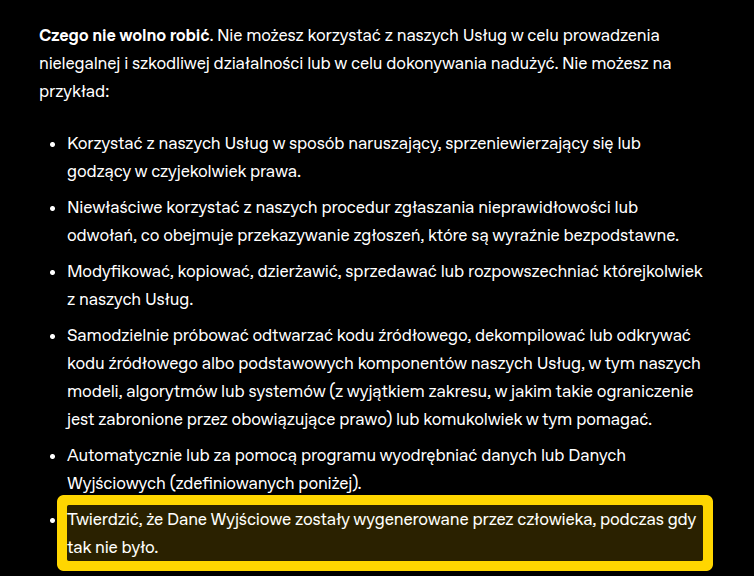
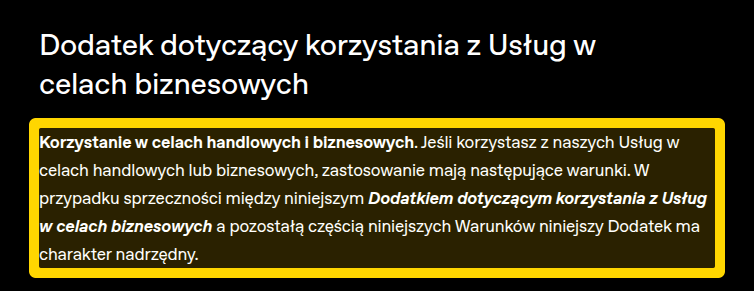

# Grafiki wygenerowane przez AI

Zgodnie z zasadami przedmiotu opisujemy tu, które grafiki w projekcie powstały z pomocą AI, jakim narzędziem
i na jakich zasadach możemy z nich korzystać.

## Co i czym wygenerowaliśmy

Grafiki wygenerowaliśmy modelem OpenAI **gpt-image-2** przez narzędzie do generowania obrazów w Codex (OpenAI),
w ramach subskrypcji ChatGPT jednego z członków zespołu.

| Grafika | Gdzie w repozytorium | Jak powstała |
|---|---|---|
| Zdjęcia pojazdów (9 aut, 5 rowerów, 37 wariantów kolorów) | `backend/seed-images/` | gpt-image-2. Każdy kolor to edycja zdjęcia bazowego tego samego pojazdu. Tło wycięliśmy lokalnie modelem BiRefNet (biblioteka [rembg](https://github.com/danielgatis/rembg)). |
| Scena z mokrym asfaltem i mgłą | `frontend/public/scene/` | gpt-image-2 |
| Tła strony z górami i mgłą | `frontend/public/bg/`, `frontend/public/hero-mgla.webp` | gpt-image-2 |
| Logo Redline Rent i monogram RR | `frontend/public/brand/`, `frontend/src/app/icon.svg` | projekt wygenerowany przez gpt-image-2, potem przerysowany na wektor (SVG) |
| Font nagłówków Ave Display | `frontend/src/fonts/` | zbudowany z pomocą AI na podstawie monogramu RR, osobne repozytorium [AveJaPl/ave-display](https://github.com/AveJaPl/ave-display) |

Odbić w asfalcie, cieni pod kołami i mgły przed pojazdami nie generuje AI. Rysuje je kod strony
(`frontend/src/components/vehicle-stage.tsx`, `frontend/src/lib/stage.ts`) na podstawie punktów styku kół
zmierzonych skryptem `scripts/vehicle_geometry.py`. Zrzuty ekranu w `docs/screenshots/` to zwykłe zrzuty
naszej strony.

## Fikcyjna firma i pojazdy

**Redline Rent to fikcyjna wypożyczalnia stworzona wyłącznie na potrzeby projektu zaliczeniowego.**

- Pojazdy na stronie to wizualizacje wygenerowane przez AI, a nie zdjęcia prawdziwej floty.
- Ceny, parametry, oceny, dostępność, adres odbioru i godziny otwarcia są przykładowe.
- Nazwy marek i modeli (Nissan, Porsche, Toyota, BMW, Audi, Dodge, Lexus, Specialized, Santa Cruz, Canyon)
  należą do ich właścicieli i są użyte wyłącznie poglądowo. Projekt nie jest powiązany z tymi firmami.
- Przy generowaniu prosiliśmy o pojazdy bez czytelnych logo i napisów, a tablice rejestracyjne są puste.

Prawdziwa wypożyczalnia powinna pokazywać zdjęcia aut, które faktycznie ma w ofercie. Inaczej wprowadzałaby
klientów w błąd.

## Czy możemy używać tych grafik

Korzystanie z narzędzi OpenAI w Europie regulują
[Warunki użytkowania w Europie](https://openai.com/pl-PL/policies/eu-terms-of-use/) w wersji z 16 stycznia 2026.
Linki w tabeli otwierają regulamin z podświetlonym fragmentem (działa w Chrome i Edge). Zrzuty poniżej
zapisaliśmy na wypadek, gdyby treść regulaminu się zmieniła.

| Zasada | Fragment regulaminu | Co to oznacza dla nas |
|---|---|---|
| Własność wyników | [Ownership of content](https://openai.com/pl-PL/policies/eu-terms-of-use/#:~:text=Ownership%20of%20content,in%20and%20to%20Output) | Między nami a OpenAI to my jesteśmy właścicielami wygenerowanych grafik, a OpenAI przenosi na nas swoje prawa do nich, w zakresie dozwolonym przez prawo. Możemy je publikować i wykorzystywać. |
| Brak wyłączności | [Similarity of content](https://openai.com/pl-PL/policies/eu-terms-of-use/#:~:text=Similarity%20of%20content,Third%20Party%20Output) | Inni użytkownicy mogą dostać podobne obrazy, więc grafiki nie są unikalne. |
| Oznaczanie | [Czego nie wolno robić](https://openai.com/pl-PL/policies/eu-terms-of-use/#:~:text=Twierdzi%C4%87%2C%20%C5%BCe%20Dane%20Wyj%C5%9Bciowe,tak%20nie%20by%C5%82o) | Nie wolno twierdzić, że wynik AI stworzył człowiek. Dlatego jawnie oznaczamy grafiki w README i w tym pliku. |
| Użycie komercyjne | [Dodatek dotyczący celów biznesowych](https://openai.com/pl-PL/policies/eu-terms-of-use/#:~:text=Korzystanie%20w%20celach%20handlowych%20i%20biznesowych) | Regulamin przewiduje korzystanie z usług w celach handlowych i biznesowych, na warunkach z dodatku. |

Najważniejsze zdanie regulaminu brzmi: „you (a) retain your ownership rights in Input and (b) own the Output”.

### Prawo autorskie w Polsce

[Ustawa o prawie autorskim i prawach pokrewnych](https://isap.sejm.gov.pl/isap.nsf/DocDetails.xsp?id=WDU19940240083),
art. 1 ust. 1:

> Przedmiotem prawa autorskiego jest każdy przejaw działalności twórczej o indywidualnym charakterze,
> ustalony w jakiejkolwiek postaci, niezależnie od wartości, przeznaczenia i sposobu wyrażenia (utwór).

Twórcą w rozumieniu ustawy jest człowiek. Obraz wygenerowany w całości przez AI najpewniej nie jest więc
utworem chronionym prawem autorskim. W praktyce oznacza to, że możemy z tych grafik swobodnie korzystać,
ale nie mamy do nich wyłącznych praw i nie zabronimy innym ich kopiowania. To nasza interpretacja na potrzeby
projektu, a nie porada prawna.
